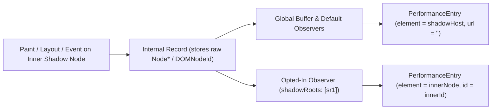

# Shadow DOM in Web Performance APIs: Spec & Implementation Research

Web Performance APIs currently handle Shadow DOM inconsistently across specifications and browser engines. In Chromium, no Web Performance API distinguishes between `open`, `closed`, and User-Agent (browser-internal) shadow roots—all three rely on `Node::IsInShadowTree()`. However, the APIs split into three behaviors: some measure shadow content with `null` attribution (LCP, CLS), one retargets to the shadow host (Event Timing), and others drop shadow nodes entirely before creating entries (Element Timing, Container Timing).

---

## 1. Current State Matrix: Specs vs. Chromium

| API | Open / Closed / UA Measured in Chromium? | Chromium Attribution (`element` / `target` / `node`) | Other Attributes Exposed in Chromium | Spec Status & Browser Interop |
| :--- | :--- | :--- | :--- | :--- |
| **Paint Timing** (FP / FCP) | **Yes** (all 3) | N/A (no node attribute) | `startTime` | **Spec bug:** `mark paint timing` checks `doc's descendants` (excludes shadow trees). Chromium & Firefox include shadow trees. |
| **LCP** | **Yes** (all 3) | `element: null` (unless inline text aggregates to a light-DOM block ancestor) | `size`, `renderTime`, `loadTime`, and **`url`** (for images/videos); `id` is `""` | **Spec contradiction:** candidate loop checks `exposed for paint timing` (excludes shadow), making `.element` getter's shadow note dead code. Chromium & Firefox include; **Safari excludes**. |
| **Event Timing** (INP / FID) | **Yes** (all 3) | **Retargeted** to light-DOM shadow host for composed events; `null` for shadow-confined events | `duration`, `processingStart`, `processingEnd`, `interactionId` | **Aligned:** Spec & browsers use DOM event retargeting (`finalize event timing` records final `event.target`). |
| **Layout Instability** (CLS) | **Yes** (all 3, except UA slider thumb) | `sources[i].node: null` | `value` includes shift; `previousRect` and `currentRect` **are** populated | **Intentional spec:** `unstable node set` uses `shadow-including descendant`; `node` getter returns `null`. |
| **Element Timing** | **No** (all 3 dropped) | N/A (no entry created) | N/A | **Intentional exclusion** pending opt-in design (`w3c/element-timing#3`, open since 2019). |
| **Container Timing** | **No** (shadow nodes dropped; slotted light-DOM nodes **are** tracked) | N/A (no entry for shadow nodes) | N/A | **Excluded in v1** (`w3c/container-timing#14`, `#20`, `#22`); post-OT support planned. |
| **Long Animation Frames** (LoAF) | **Yes** (all 3) | `PerformanceScriptTiming.invoker` serializes `event.currentTarget` | `TAG#id.on<event>` or `TAG[src="..."].on<event>` **even inside shadow trees** | **Spec & Blink gap:** Neither spec nor Blink checks `IsInShadowTree()` on `event.currentTarget` for LoAF `invoker`. |
| **Scroll Timing** | **Yes** (all 3) | `target: null` | Scroll metrics populated | Filtered at write and read time in Blink. |

---

## 2. Three Kinds of Shadow Roots: Open, Closed, and Browser-Internals (UA)

### Open vs. Closed Author Shadow Roots
- **Platform principle:** In WHATWG DOM and CSSWG specs (`@annevk`, `@rniwa`, `@emilio`), `mode: "open"` and `mode: "closed"` must behave **identically by default**. Global APIs must never automatically pierce `open` shadow roots.
- **What `open` actually means:** `open` only allows script holding the host element to read `host.shadowRoot` and pass that `ShadowRoot` object as an explicit capability token to APIs (e.g., `MutationObserver.observe(shadowRoot)` or `getComposedRanges({ shadowRoots: [shadowRoot] })`).
- **Chromium today:** `Node::IsInShadowTree()` ([node.h](file:///usr/local/btrfs_mount/InvestigateShadowDOM/src/third_party/blink/renderer/core/dom/node.h#L820)) and `Performance::CanExposeNode()` ([performance.cc](file:///usr/local/btrfs_mount/InvestigateShadowDOM/src/third_party/blink/renderer/core/timing/performance.cc#L1370-L1385)) return the exact same result for `kOpen` and `kClosed`.

### Browser-Internal (User-Agent) Shadow Roots
- **Chromium today:** `Node::IsInShadowTree()` is also `true` for `ShadowRootMode::kUserAgent`. As a result, Chromium currently counts **UA shadow DOM internals** in FCP, LCP, Event Timing, and CLS!
  - In [paint_timing_test_base.h](file:///usr/local/btrfs_mount/InvestigateShadowDOM/src/third_party/blink/renderer/core/paint/timing/paint_timing_test_base.h#L56-L58), tests explicitly disable `<video>` media controls so UA shadow buttons do not trigger unexpected LCP entries, and [text_paint_timing_detector_test.cc](file:///usr/local/btrfs_mount/InvestigateShadowDOM/src/third_party/blink/renderer/core/paint/timing/text_paint_timing_detector_test.cc#L481-L491) tests `<input type="file">`'s UA shadow button text as an LCP winner.
  - Only two places in Blink WebPerf check for UA shadow roots today:
    1. **CLS:** [layout_shift_tracker.cc](file:///usr/local/btrfs_mount/InvestigateShadowDOM/src/third_party/blink/renderer/core/layout/layout_shift_tracker.cc#L222-L225) specifically ignores `element->IsSliderThumbElement()` (`<input type="range">` UA thumb).
    2. **Soft Navigations:** [soft_navigation_paint_attribution_tracker.cc](file:///usr/local/btrfs_mount/InvestigateShadowDOM/src/third_party/blink/renderer/core/timing/soft_navigation_paint_attribution_tracker.cc#L36-L44) checks `if (root && root->IsUserAgent()) node = &root->host();` so modifying `<input type="button">` attributes to the `<input>`.
- **Spec direction:** In `w3c/largest-contentful-paint#152` (Apr 2026 WebPerf WG meeting) and `w3c/paint-timing#52` / PR `#73`, consensus is that **UA shadow trees are internal browser UI** and should **not** be pierced or measured as generic shadow trees. Instead:
  - Built-in elements that represent user content (`<input value="...">`, `<input placeholder="...">`, `<video poster="...">`) have explicit host-level contentfulness rules in Paint Timing.
  - Browser chrome/widgets inside UA shadow roots (e.g., `<video controls>` play/scrub buttons, `<input type="date">` calendar popups) should be excluded from FCP, LCP, Element Timing, and Container Timing.

---

## 3. Deep Dive: Key GitHub Issues & Spec Discussions

- **LCP & Paint Timing ([`w3c/largest-contentful-paint#152`](https://github.com/w3c/largest-contentful-paint/issues/152)):**
  - Opened by `@jasonwilliams` after discovering that inline `<span>` inside Shadow DOM attributed LCP `element` to `<body>` or `div#host`, while block `<p>` inside Shadow DOM emitted `element: null`.
  - **Root cause of inline vs. block quirk:** Paint Timing aggregates `Text` nodes to their CSS **containing block**. If the shadow host (`<my-element>`) and inner `<span>` are `display: inline`, the containing block is in the light DOM (`<body>` or wrapper `<div>`). If the inner element is `display: block` (`<p>`), the containing block is inside the shadow tree, so [largest_contentful_paint_calculator.cc](file:///usr/local/btrfs_mount/InvestigateShadowDOM/src/third_party/blink/renderer/core/paint/timing/largest_contentful_paint_calculator.cc#L259-L264) nulls `element` and `id`.
  - **Spec oversight:** Refactoring PR [`w3c/paint-timing#100`](https://github.com/w3c/paint-timing/pull/100) moved `mark paint timing` to use `doc's descendants` (which excludes shadow trees in WHATWG DOM terminology) and checked `If root is not a Document, return` for images. Safari/WebKit (`@smfr`) implemented and reverted Shadow DOM LCP (`310575@main` / `310655@main`) because of this spec text.
  - **Real-world RUM impact:** `@fbuecklers` documented a production e-commerce site (`connox.be`) where moving a product grid into Shadow DOM made Safari report footer text (~600ms) as LCP instead of the product grid (>2.3s), blinding RUM to real user experience.
  - **Emerging consensus (WebPerf WG Apr 2026 & Blink/Gecko F2F May 2026 with `@emilio`, `@Bas-moz`, `@noamr`, `@mmocny`):**
    1. Shadow DOM encapsulation applies to the DOM realm, not the visual/layout realm. Page-level metrics must include author Shadow DOM.
    2. Open and closed shadow roots should behave identically by default.
    3. Default attribution should **retarget to the outermost light-DOM Shadow Host** (treating the component as an opaque black box) rather than returning `element: null`.
    4. UA shadow roots should be excluded (except via explicit host rules).
- **Element Timing ([`w3c/element-timing#3`](https://github.com/w3c/element-timing/issues/3)):**
  - Open since 2019. `@nolanlawson` (Salesforce) presented 4 options at TPAC 2022:
    1. Top-down observer opt-in (`observe({ entryTypes: ['element'], shadowRoots: [...] })`).
    2. Bottom-up host delegation (`attachShadow({ delegatesElementTiming: true })`).
    3. Global exposure (rejected as breaking encapsulation).
    4. Namespaced exposure on `attachShadow`.
  - `@yoavweiss` also proposed **Option 5**: emit Element Timing globally when `elementtiming` is inside a shadow root, but retarget `entry.element` and `entry.id` to the outermost shadow host unless opted in.
- **Container Timing ([`w3c/container-timing#14`](https://github.com/w3c/container-timing/issues/14), [`#20`](https://github.com/w3c/container-timing/issues/20), [`#22`](https://github.com/w3c/container-timing/issues/22)):**
  - Explored nesting modes (`transparent`, `private`, `shadowed`), where `shadowed` mode accumulates inner painted regions into `size` / `paintedArea` while replacing `lastPaintedElement` with the shadow host.
  - Note on current Blink behavior ([container_timing_paint_attribution_tracker.cc](file:///usr/local/btrfs_mount/InvestigateShadowDOM/src/third_party/blink/renderer/core/paint/timing/container_timing_paint_attribution_tracker.cc#L21-L24)): shadow tree nodes are skipped, but **light-DOM nodes slotted (`<slot>`) into a shadow tree** still propagate and report to an ancestor light-DOM `containertiming` root!
- **Layout Instability ([`WICG/layout-instability#11`](https://github.com/WICG/layout-instability/issues/11), PR `#36`):**
  - Discussed retargeting `LayoutShiftAttribution.node` to the shadow host, but shipped `node: null` (with valid `previousRect` / `currentRect`) as a conservative v1.
- **Event Timing ([`w3c/event-timing#9`](https://github.com/w3c/event-timing/issues/9), [`#60`](https://github.com/w3c/event-timing/issues/60), [`#126`](https://github.com/w3c/event-timing/issues/126)):**
  - Deliberately chose DOM event retargeting (`event.target` at the end of dispatch) so composed events inside Shadow DOM attribute to the outermost light-DOM shadow host.
  - **Blink bug found in experimental `targetSelector`:** In [timing_utils.cc](file:///usr/local/btrfs_mount/InvestigateShadowDOM/src/third_party/blink/renderer/core/timing/timing_utils.cc#L59-L86), `EventPathToSelector()` iterates `EventPath::NodeEventContexts()` starting at index `0` (the raw inner target inside the shadow tree) and breaks at `IsA<ShadowRoot>(node)`. For clicks inside Shadow DOM, this builds a selector of the **shadow internals** instead of starting from the retargeted light-DOM host!

---

## 4. Idea 1: Page-Level APIs (FCP, LCP, Event Timing, CLS) — Null/Filter vs. Host Retargeting

For page-level metrics, paints, layouts, and interactions inside open and closed author Shadow DOM **should be reported**. The core design choice is how to expose attribution on global entries.

### Option 1A: Filter / Leave `null` at Record Time (Current LCP & CLS)
- **What it does:** Keeps `size`, `startTime`/`renderTime`, and rects, but sets `element: null` and `id: ""`.
- **Pros:** Simple; zero risk of leaking DOM node references.
- **Cons:**
  - **Destroys actionability:** RUM users see slow LCP or high CLS with `element: null` and cannot tell which custom element on the page was responsible.
  - **Inconsistent today in LCP:** [largest_contentful_paint_calculator.cc](file:///usr/local/btrfs_mount/InvestigateShadowDOM/src/third_party/blink/renderer/core/paint/timing/largest_contentful_paint_calculator.cc#L218-L235) nulls `element` and `id` for shadow images, but **still exposes `url`** (which leaks internal asset URLs from closed shadow roots). Meanwhile, inline shadow text leaks to light-DOM block ancestors.

### Option 1B: Retarget to Outermost Light-DOM Shadow Host (Current Event Timing & Emerging WG Consensus)
- **What it does:** Walks up from the inner painted/shifted/interacted node via `OwnerShadowHost()` until reaching a node in the `Document` tree, and reports that **Shadow Host** as `element` / `target` / `node`.
- **How each attribute behaves when retargeted:**

| Field | Retargeted Value | Notes / Caveats |
| :--- | :--- | :--- |
| `element` / `target` / `node` | Outermost light-DOM `shadowHost` | Matches `Event.prototype.target` retargeting. |
| `id` | `shadowHost.id` | Never expose the inner shadow element's `id`. |
| `url` (LCP image/video) | `""` (empty string) | **Important:** If an `` is inside a shadow root, exposing its internal `src` URL violates black-box encapsulation; `url` should be cleared when retargeting across a shadow boundary (unless the host itself is e.g. `<video poster="...">`). |
| `size` / `rects` | Inner candidate's visual size / rect (or clamped to host) | Visual impact is in the layout realm (already observable on screen). Reporting actual painted size/rects preserves metric accuracy. |

- **Edge cases to handle for Host Retargeting in LCP:**
  1. **Multiple LCP entries for the same host `Element`:** If small text paints inside `<my-hero>` at `t=100ms` and a large `` paints inside `<my-hero>` at `t=500ms`, both retarget `entry.element` to `<my-hero>`. LCP's internal "already reported element" tracking must continue keying on the **inner** node/record, even though the web-exposed `entry.element` is `<my-hero>` twice.
  2. **Stopping text aggregation at Shadow Boundaries:** Paint Timing's text aggregation (`set of owned text nodes`) currently walks up to the CSS containing block. If `<my-inline-component>` is `display: inline`, text inside it aggregates past the shadow host up to `<body>`. Text aggregation should stop at a `ShadowRoot` / Shadow Host boundary so attribution lands on `<my-inline-component>`, not `<body>`.
  3. **Disconnected inner node vs. connected host:** If the inner `` is removed from the shadow root before the `LargestContentfulPaint.element` getter is read, but `<my-hero>` is still connected to the `Document`, what should `entry.element` return? If retargeting happens at record/materialization time to `shadowHost`, `CanExposeNode(shadowHost)` returns `<my-hero>`.

---

## 5. Idea 2: Scoped APIs (Element Timing, Container Timing) & Observer Opt-In

Can an observer opt into measuring inside a `ShadowRoot`—similar to `MutationObserver`—where the observer's capabilities decide what gets filtered, rather than one global filter shared by all observers?

**Yes.** Both `MutationObserver` and newer Web Platform APIs (`getComposedRanges`, `caretPositionFromPoint`, `getHTML`) establish clear capability patterns for this. However, `PerformanceObserver` has a unique **global buffer & singleton entry** architecture in `PerformanceTimeline` that must be addressed.

### How Existing Platform APIs Handle Capability Opt-In

| API | Opt-In Signature | Crosses Nested Shadow Roots? | Open vs. Closed Behavior |
| :--- | :--- | :--- | :--- |
| **`MutationObserver`** | `mo.observe(shadowRoot, { subtree: true, ... })` | **No.** Walks `node.parentNode` ([node.cc](file:///usr/local/btrfs_mount/InvestigateShadowDOM/src/third_party/blink/renderer/core/dom/node.cc#L3220)), which is `null` at a nested `ShadowRoot`. | Identical (caller must hold the `ShadowRoot` JS reference). |
| **`IntersectionObserver` / `ResizeObserver`** | `io.observe(innerElement)` | N/A (observes exact `Element`; layout clipping uses flat tree). | Identical (caller must hold the inner `Element` reference). |
| **`Selection.getComposedRanges` / `Document.caretPositionFromPoint`** | `{ shadowRoots: [sr1, sr2] }` ([dom_selection.cc](file:///usr/local/btrfs_mount/InvestigateShadowDOM/src/third_party/blink/renderer/core/editing/dom_selection.cc#L649-L670)) | **Only if listed.** Unlisted nested shadow roots retarget to their host inside the listed outer shadow root! | Identical (caller must pass each `ShadowRoot` reference in `shadowRoots`). |
| **`Element.getHTML`** | `{ serializableShadowRoots: true, shadowRoots: [...] }` | **Both:** top-down via `shadowRoots: [...]`, or bottom-up if component set `attachShadow({ serializable: true })`. | `shadowRoots: [...]` works for both open and closed. |

### How `PerformanceObserver` Opt-In Could Work
```js
// Pattern A: Explicit ShadowRoot capability list (matches getComposedRanges / getHTML)
observer.observe({
  type: 'container', // or 'element', 'largest-contentful-paint', 'event', 'layout-shift'
  shadowRoots: [myShadowRoot, nestedShadowRoot]
});

// Pattern B: Subtree/Node scoping (matches MutationObserver)
observer.observe({
  type: 'element',
  node: myShadowRoot // observes only within this TreeScope (not nested shadow roots unless also observed)
});
```

- **How filtering works per-observer under `{ shadowRoots: [...] }`:**
  - When a paint/event/shift occurs on `innerNode`, the browser walks up `innerNode`'s shadow roots (`ContainingShadowRoot()` -> `OwnerShadowHost()`).
  - If a `ShadowRoot` is **not** in `observer.shadowRoots`, attribution is retargeted to its `OwnerShadowHost()` (or dropped for Element Timing if `elementtiming` was inside an un-opted-in shadow root).
  - If a `ShadowRoot` **is** in `observer.shadowRoots`, the walk stops piercing outward and exposes the node inside that `ShadowRoot`!
  - Crucially, if `sr1` is in `shadowRoots` but a nested `sr2` inside `sr1` is **not**, an event or paint inside `sr2` retargets to `sr2.host` (which lives inside `sr1`)! This gives complete composable encapsulation at every component layer.

### Architectural Challenge in `PerformanceTimeline` & Blink
Today in Blink ([performance.cc](file:///usr/local/btrfs_mount/InvestigateShadowDOM/src/third_party/blink/renderer/core/timing/performance.cc#L1237-L1249) and [performance_observer.cc](file:///usr/local/btrfs_mount/InvestigateShadowDOM/src/third_party/blink/renderer/core/timing/performance_observer.cc#L372-L384)), every `PerformanceEntry` is a **singleton** `ScriptWrappable` object shared across all `PerformanceObserver`s and `performance.getEntriesByType()`.

To support per-observer Shadow DOM opt-in without leaking inner nodes across observers:



1. **Separate Internal Record from Web-Exposed `PerformanceEntry`:**
   - Blink already does this for LCP (`ImageRecord` / `TextRecord`) and CLS (`Attribution` with `DOMNodeId`).
   - Instead of nulling `element` at record time, store the raw `Node*` (or `WeakMember<Node>`) in an internal record.
2. **Per-Observer Materialization (or Scope Bucketing):**
   - Observers with default options (`shadowRoots: []`) all share the default retargeted `PerformanceEntry` singleton (which also goes into the global `performance.getEntriesByType()` buffer).
   - Observers that pass `shadowRoots: [...]` receive a `PerformanceEntry` instance whose `element`, `id`, `url`, `lastPaintedElement`, or `target` is resolved against that observer's `shadowRoots` set.
3. **Pre-Paint / Paint Tracking Activation:**
   - Currently, Element Timing ([element_timing.cc](file:///usr/local/btrfs_mount/InvestigateShadowDOM/src/third_party/blink/renderer/core/paint/timing/element_timing.cc#L70)) and Container Timing ([container_timing_paint_attribution_tracker.cc](file:///usr/local/btrfs_mount/InvestigateShadowDOM/src/third_party/blink/renderer/core/paint/timing/container_timing_paint_attribution_tracker.cc#L22)) skip all shadow nodes early during pre-paint/paint.
   - With observer opt-in, a `TreeScope` (`ShadowRoot`) can have a flag (e.g., `HasScopedPerformanceObserver()`) set when an observer registers `shadowRoots: [sr]`, enabling Element/Container Timing tracking inside that `ShadowRoot`.
4. **How `{ buffered: true }` Interacts with Scoped Observers:**
   - `MutationObserver` and `IntersectionObserver` do **not** have `{ buffered: true }` for arbitrary past history; they only observe from registration onward.
   - For `PerformanceObserver`, if an opted-in observer passes `{ buffered: true, shadowRoots: [sr] }`, should it see past Element Timing / Container Timing paints inside `sr` that happened *before* any observer opted into `sr`?
   - **Option i (Live-only for opted-in shadow trees):** Like `MutationObserver`, Element/Container Timing inside a `ShadowRoot` is only tracked once an observer opts in (or if a declarative attribute opted in). This avoids tracking every shadow tree on every page "just in case" a future observer passes `{ buffered: true, shadowRoots: [sr] }`.
   - **Option ii (Page-level metrics like LCP / Event Timing / CLS):** Since LCP, Event Timing, and CLS *already* record every candidate/event/shift globally, internal records could retain a `WeakMember<Node>` to the raw inner target, allowing `{ buffered: true, shadowRoots: [sr] }` to materialize inner attribution for buffered page-level entries!

---

## 6. Other Ideas & Design Patterns in the Ecosystem

Beyond **Idea 1 (Host Retargeting)** and **Idea 2 (Top-Down Observer Capability Opt-In)**, three additional mechanisms have appeared in W3C discussions:

### Idea 3: Bottom-Up Component Delegation (`attachShadow` / Declarative Shadow DOM)
- **Source:** `w3c/element-timing#3` (`@annevk`, `@rniwa`, `@smaug----`) and `Element.prototype.getHTML` (`serializable`).
- **Mechanism:** The component author declares that its shadow root delegates performance attribution outward:
  ```js
  this.attachShadow({ mode: 'open', delegatesPerformance: 'retarget' | 'expose' });
  // or declarative: <template shadowrootmode="open" shadowrootdelegatesperformance>
  ```
- **Pros:** Solves the deeply nested Web Component app problem (`@nolanlawson` at Salesforce, where apps have 20+ nested shadow roots and passing every `ShadowRoot` reference down to a top-level RUM observer is impractical). Also works seamlessly with `{ buffered: true }` from initial HTML parse via Declarative Shadow DOM!
- **Cons:** Third-party components that don't set the flag remain black boxes unless paired with Idea 1 (host retargeting by default) or Idea 2 (observer `shadowRoots` override).

### Idea 4: Declarative Attribution / Nesting Modes (`containertiming-mode="shadowed"`)
- **Source:** `w3c/container-timing#22` (`@mmocny`, `@jasonwilliams`).
- **Mechanism:** Formalizes `"shadowed"` as a general attribution boundary mode (applicable to both Shadow Hosts and light-DOM containers): inner paints contribute to `size` and timestamps, while node attribution (`lastPaintedElement`, `element`, `id`) is capped at the boundary element.
- **Pros:** Unifies Shadow DOM retargeting and light-DOM component encapsulation under a single spec primitive (`exposed or retargeted for paint timing`).

### Idea 5: TreeScope-Scoped Observation (`ShadowRoot` as Observation Root)
- **Source:** `MutationObserver` and `w3c/largest-contentful-paint#152` (Blink/Gecko F2F).
- **Mechanism:** Allow `observer.observe({ type: 'element', root: shadowRoot })` where `root` sets the **root `TreeScope`** for that observation, rather than mixing light-DOM and shadow-DOM entries in one global observer stream.
- **Pros:** Cleanly scopes Element Timing and Container Timing to a single component's shadow tree (matching `MutationObserver` semantics: one `ShadowRoot` per registration, never crossing into nested child shadow roots, and never polluting `window.performance.getEntries()`).
- **Cons:** Less ergonomic for page-wide RUM scripts that want one timeline piercing a known list of `shadowRoots`.

---

## 7. Summary of Recommended Direction & Open Questions

1. **Separate UA Shadow DOM from Author Shadow DOM:**
   - Update Paint Timing, LCP, Event Timing, and CLS specs and Blink (`Node::IsInShadowTree()` callers) so **User-Agent shadow trees** (`ShadowRoot::IsUserAgent()`) are ignored unless explicitly specified via host element rules (e.g., `<input value>`, `<video poster>`).
2. **Page-Level APIs (Idea 1 — Host Retargeting by Default):**
   - Keep measuring open and closed author Shadow DOM in FCP, LCP, Event Timing, and CLS.
   - Standardize **retargeting to the outermost light-DOM Shadow Host** for `LCP.element`, `CLS.sources[i].node`, and `EventTiming.target` (already done in Event Timing).
   - Strip inner `id` (use `host.id`) and strip inner `url` (set to `""` when retargeted across a shadow boundary in LCP).
   - Stop Paint Timing text aggregation at Shadow Root / Host boundaries even when the host is `display: inline`.
   - Fix Blink's experimental `EventPathToSelector` (`timing_utils.cc`) and LoAF `EventTargetToString` (`currentTarget`) so they do not leak inner shadow `#id` / `[src]` strings.
3. **Scoped APIs & Deep Inspection (Idea 2 + Idea 3):**
   - For **Element Timing** and **Container Timing** (and optional deep attribution in LCP / Event Timing / CLS), introduce a capability opt-in on `PerformanceObserver.observe()`—either `{ shadowRoots: [...] }` (matching `getComposedRanges` / `getHTML`) or `{ node: shadowRoot }` (matching `MutationObserver`).
   - Consider pairing top-down `{ shadowRoots: [...] }` with bottom-up Declarative Shadow DOM opt-in (like `getHTML`'s `serializableShadowRoots` + `shadowRoots`) for apps with deeply nested custom elements that need `{ buffered: true }` from initial page load.
   - In `PerformanceTimeline` / Blink, keep raw `Node*` in internal records and materialize retargeted vs. inner `PerformanceEntry` instances per observer scope, keeping the global `performance.getEntriesByType()` buffer strictly retargeted to light DOM.
